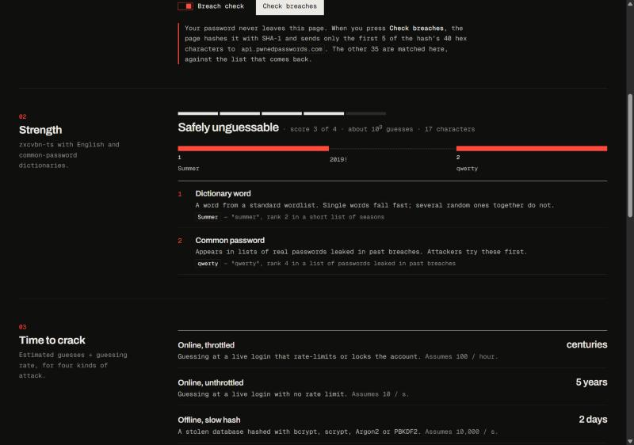
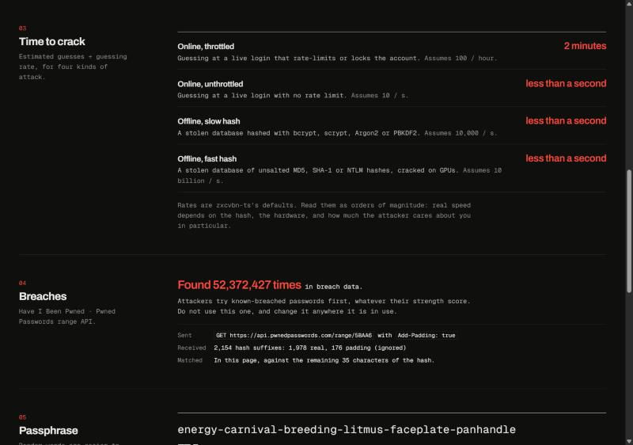
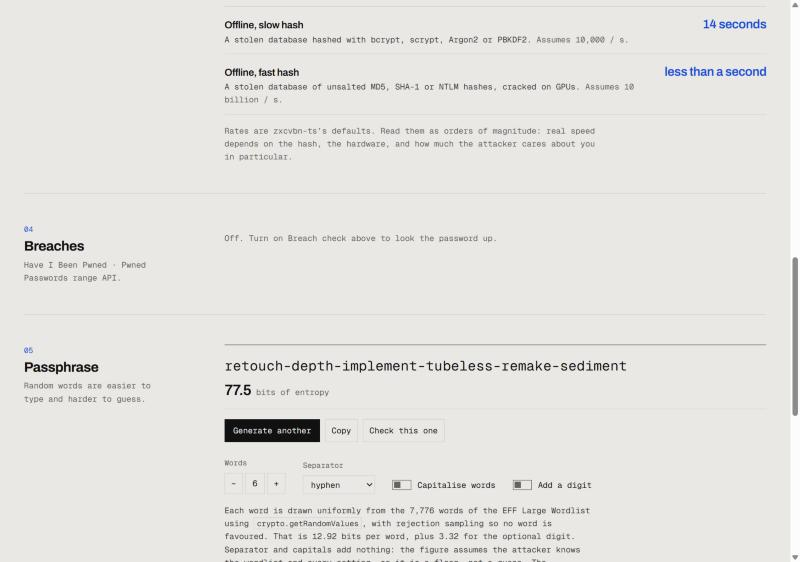

# pwcheck

A password strength and breach checker that runs in the browser. It is built to sit at
`saafirhale.com/tools/password`, beside a companion .eml phishing analyzer.

- **Strength.** [zxcvbn-ts](https://github.com/zxcvbn-ts/zxcvbn) with its English and common
  dictionaries scores the password 0–4 and works out how it would be guessed. Each weakness it finds
  (common password, dictionary word, name, letter substitution, reversed word, keyboard walk, repeat,
  sequence, date, recent year) is explained in plain language, with crack times under four attack
  models.
- **Breach check.** Uses the [Pwned Passwords](https://haveibeenpwned.com/Passwords) range API with
  k-anonymity. The SHA-1 is computed locally with Web Crypto, only its first 5 hex characters are sent,
  and the remaining 35 are matched in the page. `Add-Padding: true` is set so the response size gives
  nothing away. A switch turns the check off completely for strength-only, offline use.
- **Passphrase generator.** Draws from the EFF Large Wordlist with `crypto.getRandomValues` and
  shows the exact entropy in bits.

No analytics, no cookies, no browser storage. The tool makes no `console` calls.





## Threat model

### What is being protected

The password typed into the field. A secondary concern is any passphrase the generator produces.

### What leaves the page

| Mode | Network traffic caused by the tool |
| --- | --- |
| Breach check **off** | None. Strength is computed in the page. |
| Breach check **on**, before pressing the button | None. Strength is computed in the page. |
| Breach check **on**, after pressing **Check breaches** | `GET https://api.pwnedpasswords.com/range/XXXXX` with `Add-Padding: true`, where `XXXXX` is the first 5 hex characters of SHA-1(password). The browser may send a CORS preflight (`OPTIONS`) to the same URL first, because `Add-Padding` is not a CORS-safelisted header. |

The request is made with `credentials: "omit"`, `cache: "no-store"` and
`referrerPolicy: "no-referrer"`. Like any HTTP request, it still carries the visitor's IP address,
user agent and an `Origin` header naming the site. The service sits behind Cloudflare (its responses
carry `Server: cloudflare`), so Cloudflare sees the request as well as Have I Been Pwned.

The password itself, the full hash, and the 35-character suffix are never sent. The tests assert this
against the exact URL and request options passed to `fetch`. The UI's **Sent** line shows the URL
that was actually requested.

### What the 5-character prefix still reveals

The prefix is 20 bits of the hash, one of 16⁵ = 1,048,576 buckets.

- If the password **is** in the breach corpus, an observer who sees the prefix knows the password is
  one of the real entries in that bucket. For the recorded fixture (`5BAA6`) there were 1,977 real
  entries; a live request during testing returned 1,978.
- If the password **is not** in the corpus, the prefix lets someone with a candidate list discard
  about 1,048,575 of every 1,048,576 wrong guesses without testing them against an account. It does
  not reveal the password, but it does narrow a targeted offline search.

That second point drives a design decision. **The breach check runs on a button press, never as you
type.** Checking on every keystroke would send a prefix for `p`, `pa`, `pas`, … Each of those short
fragments can be recovered from its prefix by brute force in moments, which would leak the password
one character at a time.

### Padding

With `Add-Padding: true`, the service adds fake entries with a count of 0. The real entries in a bucket
vary in number, so without padding the response size could hint at which bucket was requested to
someone watching encrypted traffic. Padding entries are counted for display and then dropped before
matching. A suffix that appears only as padding is reported as not found (tested).

### Adversaries considered

| Adversary | Position | Mitigation |
| --- | --- | --- |
| Network observer | Between browser and service | TLS; padded responses; only the prefix in the URL. |
| Service operator / CDN | Receives the request | k-anonymity: sees the 5-character prefix, IP, user agent and Origin. Cannot recover the password from that alone. Users who do not accept this can switch the check off. |
| Shoulder surfer / screen share | Sees the screen | Field is masked by default. Weakness details derived from the password (matched text, decoded word, rank) are shown only after **Show** is pressed; until then only character positions are shown. |
| Browser autofill and password managers | Same device | `autocomplete="off"`, no `name` attribute, and the 1Password, LastPass and Bitwarden opt-out attributes. Most honour these; a browser may still offer to save a typed password. |
| Host page and supply chain | Same origin | Out of scope for the component. The demo build ships a Content-Security-Policy whose only outside `connect-src` is `https://api.pwnedpasswords.com`, with `script-src 'self'` and no inline or `data:` assets. Dependencies are pinned in `package-lock.json`. |

### Out of scope, and known limits

- **Memory.** JavaScript strings cannot be wiped. The password stays in the tab's memory while it is in
  the field, and until garbage collection after that. The encoded bytes passed to Web Crypto are zeroed
  after hashing; the string itself cannot be.
- **Malicious extensions** can read any page. Nothing a web page does prevents that.
- **SHA-1** is used because the Pwned Passwords corpus is keyed by it. It is not used to protect
  anything. The hash is taken over the exact UTF-8 bytes typed, with no Unicode normalisation, to match
  how the corpus was built.
- **Strength is an estimate.** zxcvbn-ts models a smart guesser using English wordlists. It
  under-rates passwords built from patterns it does not know and is less informed about other
  languages. Its fuzzy (Levenshtein) matching is off because it cost about a second per check in
  testing, too slow to run on every keystroke. Near-misses such as `p@ssw0rd` and `drowssap` are still
  caught by the l33t and reversal rules.
- **Crack-time rates** are zxcvbn-ts's defaults: 100 guesses per hour (online, throttled), 10 per
  second (online, unthrottled), 10⁴ per second (offline, slow hash), 10¹⁰ per second (offline, fast
  hash). Real attacks vary by orders of magnitude with the hash and hardware, and the UI says so.
- **"Not found" is not "strong".** The corpus contains passwords from known breaches only. The UI
  says this next to every not-found result.
- **Clipboard.** A copied passphrase stays on the system clipboard until something replaces it. The
  UI says so.

## Passphrase entropy

Each word is an independent, uniform pick from the 7,776-word EFF Large Wordlist, so a word is worth
log₂ 7776 ≈ 12.925 bits. Six words give 77.5 bits. The optional appended digit adds log₂ 10 ≈ 3.32
bits. Separator and capitalisation are fixed settings rather than random choices, so they add nothing.
The figure assumes the attacker knows the wordlist and every setting, which makes it a lower bound
rather than an estimate.

Indices are drawn from 32-bit values from `crypto.getRandomValues` with rejection sampling. Values in
the top `2³² mod 7776` of the range are discarded so that no word is more likely than another. The
tests drive this with a scripted random source to check the rejection boundary.

## Layout

```
src/core/            framework-agnostic, no DOM beyond Web Crypto and fetch
  hibp.ts            sha1Hex, splitHash, parseRange, matchSuffix, checkPwned
  strength.ts        loadStrengthEstimator, attack models, plain-language weaknesses
  passphrase.ts      generatePassphrase, uniformIndex, entropyBits
  eff-large-wordlist.ts  generated from data/eff_large_wordlist.txt
src/react/           PasswordChecker, PassphraseGenerator, styles.css
demo/                Vite page styled like saafirhale.com
test/                Vitest; test/fixtures holds the recorded range response
```

## Use

```bash
npm install
```

```bash
npm test
```

```bash
npm run dev
```

The dev server runs on port 5179. `npm run build:demo` writes the static page, with its CSP, to
`dist-demo/`, and `npm run preview` serves that build on port 5180. `npm run build` emits the
library to `dist/`.


### In a Next.js page

```tsx
import { PasswordChecker } from "@saafirhale/pwcheck/react";
import "@saafirhale/pwcheck/styles.css";

export default function Page() {
  return <PasswordChecker userInputs={["saafir", "hale", "saafirhale"]} />;
}
```

The component files start with `"use client"`. The stylesheet reads the host's `--bg`, `--fg`,
`--fg2`, `--muted`, `--line`, `--accent`, `--font-display` and `--font-mono` tokens, which
saafirhale.com's `globals.css` defines for both themes. It falls back to the site's dark values when
those tokens are absent. Passphrases are generated in an effect, so a statically rendered page never
ships one in its HTML.

Props: `userInputs` (words zxcvbn should treat as guessable, such as site and user names),
`defaultBreachCheck` (default `true`), `generator` (default `true`), `endpoint` (override the range
URL), `className`.

## Tests

`npm test` runs 59 tests.

- **k-anonymity** (`test/hibp.test.ts`), against a range response for prefix `5BAA6` recorded on
  26 Oct 2026 with `Add-Padding: true` and stored byte for byte (CRLF line endings preserved by
  `.gitattributes`). Covers: Web Crypto SHA-1 against Node's, for non-ASCII input too; the 5/35 split;
  uppercasing of lowercase hashes; every line counted as real or padding; padding dropped from the
  lookup table; a padding suffix reported as 0; case-insensitive matching on both sides; LF and CRLF
  bodies; malformed bodies throwing instead of reading as "not found"; HTTP errors throwing; the
  request URL and options, with nothing in them carrying the password or suffix.
- **Strength** (`test/strength.test.ts`): every weakness kind is detected on a known example, titles
  and details never contain the matched text, crack time equals guesses divided by rate, and the
  rates match zxcvbn-ts's defaults.
- **Passphrase** (`test/passphrase.test.ts`): the wordlist is 7,776 unique words and matches the
  vendored EFF file by SHA-256; rejection sampling is checked at the boundary; separator,
  capitalisation and digit work; entropy is computed exactly.

## Credits and licences

- **EFF Large Wordlist**, by the Electronic Frontier Foundation (<https://www.eff.org/dice>), used under
  [CC BY 4.0](https://creativecommons.org/licenses/by/4.0/) per <https://www.eff.org/copyright>.
  Vendored unmodified as `data/eff_large_wordlist.txt` (SHA-256
  `addd35536511597a02fa0a9ff1e5284677b8883b83e986e43f15a3db996b903e`). The generated module drops
  the dice numbers and keeps the words in order. The credit is also shown in the UI.
- **zxcvbn-ts** core and language packs: MIT.
- **Pwned Passwords**: [Have I Been Pwned](https://haveibeenpwned.com/Passwords). The recorded fixture
  is a single API response, kept for tests.
- **Archivo** and **Geist Mono** (demo only, self-hosted via Fontsource): SIL Open Font License 1.1.

Code: MIT, © 2026 Saafir Hale. See `LICENSE`.
